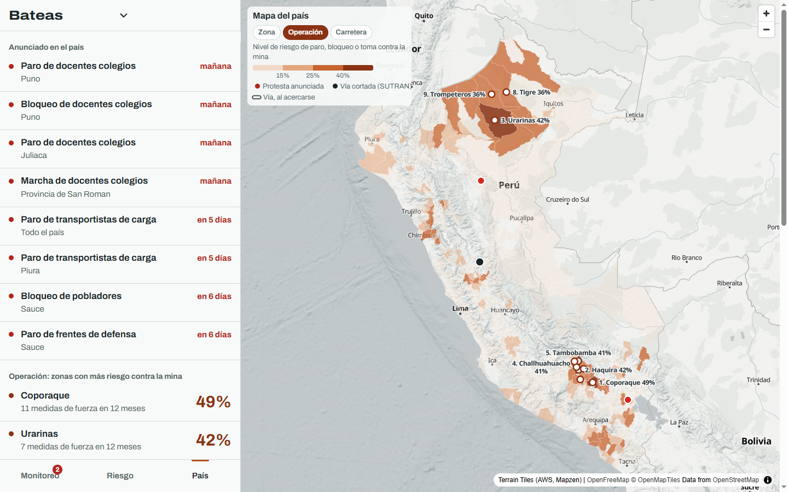
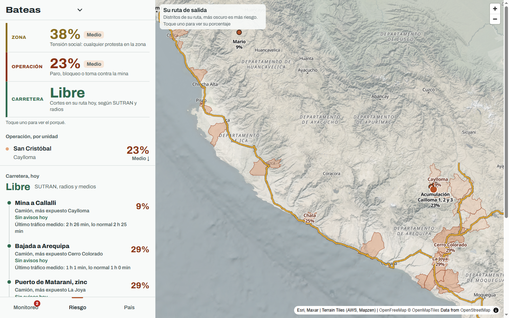
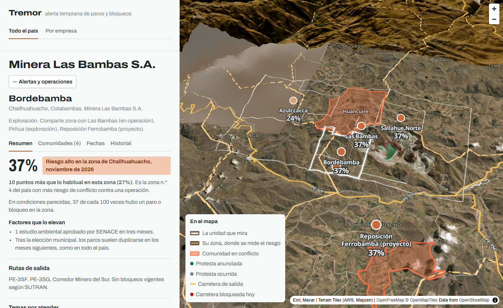
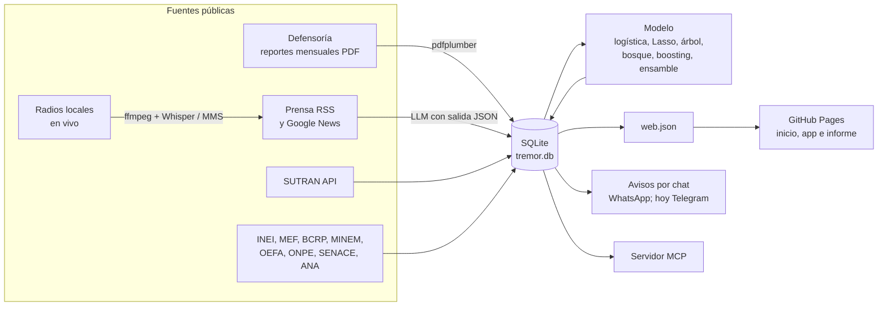

# Tremor

**Escuchamos el temblor antes del conflicto.**

Inicio: **https://nicosil02.github.io/tremor/** · App: [app.html](https://nicosil02.github.io/tremor/app.html) ·
Informe mensual de muestra:
[informe.html](https://nicosil02.github.io/tremor/informe.html) · Cómo se calcula:
[metodo.html](https://nicosil02.github.io/tremor/metodo.html)

Proyecto final de la Diplomatura Q-Lab PUCP (issue #204 de `d2cml-ai/Data-Science-Python`).

## 1. One-liner

Avisamos a mineras medianas, petroleras y concesionarias dónde está subiendo el riesgo de un paro, un bloqueo o una
toma contra sus operaciones, con sus razones, leyendo cada día la Defensoría, la SUTRAN, la prensa y las radios
locales con IA.

## 2. Founder

Nicolás Silva Andújar, politólogo, predocente de la PUCP y consultor de asuntos públicos. Trabajo en lo que este
producto resuelve: explicarle a una empresa qué está pasando con el Estado y con la sociedad alrededor de su
negocio, antes de que le cueste. Llevo años leyendo los reportes de conflictos de la Defensoría y construyendo
herramientas de monitoreo de datos públicos, y Tremor junta las dos cosas.

## 3. Problema

**Quién lo sufre.** Los equipos de relaciones comunitarias y asuntos corporativos de las empresas extractivas,
sobre todo las medianas, que tienen operaciones en zonas sensibles y equipos pequeños. En agosto de 2026 la
Defensoría registró 188 conflictos sociales, 92 socioambientales, y el 66,3% de estos vinculados a la minería
([Revista Economía](https://www.revistaeconomia.com/?p=143821)).

**Cuánto cuesta.**

- Un día de bloqueo en Las Bambas equivale a unos US$9,5 millones de exportaciones que no salen, según la SNMPE
  ([ProActivo](https://proactivo.com.pe/snmpe-perdidas-de-las-bambas-ascienden-a-us-9-5-millones-diarios/)). Desde
  2016 la mina acumuló cerca de 600 días de bloqueos de vías
  ([ProActivo](https://proactivo.com.pe/las-bambas-perdio-mas-de-ano-y-medio-de-produccion-desde-su-inicio-de-operaciones-en-2016/)).
- Con Las Bambas y Cuajone bloqueadas a la vez, el país dejaba de exportar US$20 millones y de recaudar US$7
  millones por día ([Guía Minera](https://www.guiaminera.cl/peru-pierde-us20millones-en-exportaciones-y-us7millones-en-impuestos-por-cada-dia-de-bloqueo-a-empresas-mineras/)).
- El IPE estimó que los conflictos le costaron más de S/1 500 millones a la minería solo en 2021
  ([Lampadia](https://lampadia.com/opiniones/ipe/conflictos-sociales-costaron-mas-de-s-1-500-millones-a-la-mineria)).
- Proyectos como Conga (US$4 800 millones) y Tía María llevan años detenidos
  ([ProActivo](https://proactivo.com.pe/inversiones-mineras-paralizadas-suman-mas-de-us-25-mil-millones/)).

Para una minera mediana que vende entre US$100 y 300 millones al año, un día parada son cientos de miles de
dólares.

**Cómo lo resuelven hoy.** Leen el reporte mensual de la Defensoría, que llega con un mes de rezago, pagan
monitoreo de medios y dependen de lo que cuentan sus relacionistas en campo. Nadie escucha las radios provinciales,
que es donde se anuncian los paros, y nadie compara una zona con su propia historia para saber si este mes está
peor que lo normal.

**Conversaciones con usuarios potenciales.** Las notas de las tres conversaciones están en
[`docs/research/`](docs/research/).

## 4. Solución e insight

Tremor es una página con un mapa de las 1 514 operaciones extractivas del país y, para cada empresa, sus alertas,
su riesgo y un informe mensual listo para enviar.

- **Tres riesgos, separados.** *Zona*: tensión social, la probabilidad de cualquier protesta en el distrito de la
  operación y sus vecinos en los próximos tres meses. *Operación*: la de un paro, bloqueo o toma contra la mina en
  ese mismo plazo, con cuánto sube frente a lo habitual, por qué, y en qué puesto está en el país. *Carretera*:
  los cortes de hoy en su ruta, según la SUTRAN y las radios, sin modelo. Los dos primeros son niveles de riesgo,
  no una fecha, y los calcula un modelo entrenado solo con historia y datos del territorio: lo que dicen los
  medios no entra al modelo, va al monitoreo.
- **Monitoreo en vivo.** La prensa regional, la SUTRAN y 286 radios locales de 139 provincias se leen cada día.
  Un LLM codifica cada nota con el manual de la base de protestas de la PUCP. Las protestas anunciadas aparecen
  como alerta antes de que ocurran.
- **Avisos por WhatsApp.** Cada cliente recibe en su chat solo lo que toca a sus operaciones y su ruta: protestas
  anunciadas, bloqueos de la SUTRAN y tramos lentos, con qué hacer. Si el paro se suspende o los gremios se retiran,
  también se avisa.
- **Su ruta de salida.** Cada tramo de la mina al puerto, con el riesgo de los distritos que cruza y el tiempo de
  viaje medido cada hora. Al tocar un tramo, un camión o el tren en 3D lo recorre: se detiene en un bloqueo, avisa
  una protesta anunciada y va más lento si hay tráfico.
- **Contexto de cada zona.** Comunidades campesinas y nativas, conflictos abiertos en la Defensoría, rutas de
  salida, canon, producción minera del MINEM y lo que se reclama.

**El insight.** El cliente ya sabe que Challhuahuacho es conflictivo. Lo que no sabe es cuándo una zona está peor
que su propio normal, ni lo que se dice en la radio de la provincia esta mañana. El valor no es adivinar el día del
paro. Es ordenar todas las zonas por riesgo con razones verificables y avisar cuando algo cambia.

**Qué tan bien funciona.** Lo medimos en 2024-2026, un periodo que el modelo no vio al entrenar.

- Entre las 20 zonas que más alerta, el 27% tuvo un conflicto contra la operación en los tres meses siguientes. La
  regla obvia, "donde hubo, habrá", acierta 19%, y la tasa base es 11%. El modelo le gana a esa regla en las cuatro
  ventanas probadas desde 2016.
- En el [expediente de casos](docs/casos.md), de 132 medidas de fuerza contra operaciones desde 2024, el modelo
  tenía la zona entre el 5% más riesgoso antes del 48%. Con la regla obvia, juntos llegan a 61%. Hay 23 casos que
  el modelo vio y la regla no, como Velille (Constancia) y Pallpata (Antapaccay).
- No predice crisis con víctimas mejor que la regla obvia, y no lo prometemos.

## 5. Why now

- **Los LLM abiertos son gratis o casi.** Codificar miles de notas con un manual académico costaba un equipo de
  codificadores. Hoy lo hace un modelo abierto dentro de un cupo gratuito.
- **La voz se transcribe en una CPU.** Whisper transcribe radios en castellano sin GPU, y los modelos MMS de Meta
  empiezan a entender quechua y aimara, que es donde ocurre el conflicto rural.
- **Los datos públicos ya están abiertos.** La API pública de la SUTRAN, los reportes de la Defensoría desde 2004,
  la producción por unidad del MINEM desde 2001 y la base de protestas de la PUCP.
- **El momento.** El cobre está en máximos y la cartera minera suma 66 proyectos por US$64 000 millones
  ([Revista Economía](https://www.revistaeconomia.com/?p=143821)). Después de las elecciones municipales de octubre
  de 2026, los paros suelen subir en los meses siguientes.

## 6. Demo

**URL:** https://nicosil02.github.io/tremor/. El inicio explica qué hacemos, los planes y quién está detrás. Desde
**Ver la demo** se entra a la app de una empresa, por ejemplo Bateas, y **Acceso de clientes** a la de la empresa
que se elija. La misma app corre en Streamlit Community Cloud, con todas las mineras y la página de datos del
modelo: **https://tremormonitor.streamlit.app/** (`streamlit_app.py`). El acceso con usuario y contraseña por
cliente está listo en `tremor/acceso.py` y se activa con el contrato.

- **Monitoreo:** lo que dicen hoy radios, medios, la Defensoría y la SUTRAN, y qué atender;
- **Riesgo:** los tres niveles, Zona, Operación y Carretera, cada unidad y cada tramo de su ruta (al tocar un
  tramo, el vehículo lo recorre);
- **País:** todas las zonas con operación extractiva, con las tres capas en el mapa.

Como hoy ningún tramo tiene un paro, cada caso se puede ver con `?prueba=corte`, `aviso` o `lento`, por ejemplo
https://nicosil02.github.io/tremor/app.html?e=Bateas&prueba=corte (el aviso dice "prueba").

**Video de respaldo (72 s):** https://github.com/nicosil02/tremor/releases/download/demo/tremor-demo.mp4. Se genera con
Remotion desde [`video/`](video/) con los datos reales de la app.

| Todo el país | Una empresa | Una unidad |
|---|---|---|
|  |  |  |

**Arquitectura.**



Tres workflows de GitHub Actions mantienen todo al día y publican la base en la rama `datos`:

- `defensoria.yml` cada media hora, con la Defensoría, la SUTRAN, la prensa y la reputación;
- `radio.yml` cinco veces al día, de lunes a sábado;
- `modelo.yml` el día 20 de cada mes.

**Modelos y APIs, y por qué.**

| Pieza | Qué usa | Por qué |
|---|---|---|
| Codificar notas | `openai/gpt-oss-120b` en Groq, con Gemini Flash Lite y `gpt-oss-20b` de respaldo, por un endpoint compatible con OpenAI | Modelos abiertos con cupo gratuito diario. Si uno se agota, sigue el siguiente. Todo queda en caché y volver a correr no gasta cupo |
| Transcribir radio | `faster-whisper small` en CPU (int8). Para quechua y aimara, `facebook/mms-1b-all` | Corre gratis en las máquinas de GitHub, sin GPU |
| Predecir | scikit-learn con validación temporal, calibración isotónica y elección del ganador en 2021-2023 | Explicable por grupos de variables. La prueba 2024-2026 no se toca hasta el final |
| Mapa | MapLibre GL, relieve de AWS Terrain Tiles e imagen satelital de Esri | Página estática, sin servidor |

**Cómo correrlo en local.**

```bash
git clone https://github.com/nicosil02/tremor && cd tremor
pip install -r requirements.txt
cp .env.example .env                      # LLM_API_KEY de Groq, opcional para ver la demo
git fetch origin datos && git show origin/datos:tremor.db.gz > tremor.db.gz
python -c "import gzip,shutil;shutil.copyfileobj(gzip.open('tremor.db.gz'),open('datos/tremor.db','wb'))"
python -m tremor.web && cp datos/exportes/web.json docs/web.json
python -m http.server -d docs 8000        # abrir http://localhost:8000
streamlit run streamlit_app.py            # la misma app más los datos del modelo, como en Streamlit Cloud
python -m pytest -q                       # 156 pruebas
```

## 7. Modelo de negocio

**Quién paga.** La gerencia de relaciones comunitarias o de asuntos corporativos de la empresa. Hoy ese
presupuesto ya paga monitoreo de medios y reportes de consultoras.

**Precio.**

| Plan | Qué incluye | Precio |
|---|---|---|
| Piloto | Una operación y su ruta por 3 meses, para medir si avisó algo que el equipo no sabía | US$4 500 en total |
| Operación | Mapa, alertas diarias, radio y prensa de su zona e informe mensual | US$1 500 al mes por operación |
| Empresa | Grupos de 3 a 5 operaciones, informe a medida e integración de sus propios registros de quejas y compromisos | US$40 000 al año |

Un solo día de paralización evitado o acortado en una mina mediana paga varios años del plan.

**Cuánto cuesta operarlo.** La demo corre gratis para probar la idea. Con un contrato, el costo sube a propósito
para que el servicio no falle ni se pierda nada. Casi todo es fijo y se reparte entre los clientes, porque las radios y
la prensa se leen para el país entero.

| Pieza | Demo de hoy | Con contrato |
|---|---|---|
| LLM | Groq en cupo gratuito: unas 200 notas al día, el resto espera al día siguiente | Todas las notas el mismo día, unas 3 000 al día. Con Claude Sonnet 5.5 (US$2 por millón de tokens de entrada y US$10 de salida) son unos 135 millones de entrada y 27 de salida al mes, cerca de **US$540 al mes**, o la mitad en lote. Un modelo más grande puede escribir el informe de cada cliente por unos pocos dólares más |
| Radio | Máquinas de GitHub en CPU, tres franjas al día, de lunes a sábado. Gratis porque el repo es público | Servidor con GPU propio, más radios, más horas y quechua y aimara completos: **US$500 a 800 al mes** |
| Página, datos y alertas | GitHub Pages, sin costo | Servidor propio con acceso por cliente y avisos por correo o WhatsApp (centavos por conversación): **US$50 a 100 al mes** |
| Tráfico en las rutas | Cupo gratuito | Tiempos de viaje de cada tramo cada hora: **unos US$50 al mes** |
| **Total** | **US$0** | **US$1 150 a 1 500 al mes** |

**Por qué la radio cuesta.** No hay forma de leer una radio más rápido de lo que habla: hay que grabarla mientras
transmite y luego pasar el audio a texto, que es lo que más cálculo consume. Con tres franjas de una hora en 280
radios son unas 840 horas de audio al día. En CPU eso ocupa decenas de máquinas. Una GPU lo transcribe varias decenas
de veces más rápido, y por eso conviene pagarla cuando hay contrato.

**Costo por cliente.** Con el supuesto de una operación que recibe unos 40 avisos al mes, 300 notas y 60 fragmentos de radio codificados para su zona y un informe mensual: unos US$25 al mes en tokens y US$30 de servidor y mensajería, cerca de **US$55 por cliente**, frente a los US$1 500 del plan; el resto del costo es fijo y se reparte.

Cada plan cubre por sí solo el costo de operar. Un piloto o una operación pagan US$1 500 al mes, y el plan Empresa unos US$3 300. Desde ahí, cada cliente adicional es casi todo margen,
porque su informe y sus alertas salen de los mismos datos. Mientras haya pocos clientes, la revisión de los avisos dudosos y del informe
mensual la hace el fundador; un analista a medio tiempo (unos US$800 al mes) entra a partir del tercer cliente.

**Cómo llegamos a los primeros clientes.** Pilotos con 3 a 5 mineras medianas del sur andino, empezando por las
que tienen operaciones en el Corredor Minero del Sur. La prueba de valor es el [expediente de casos](docs/casos.md)
de cada una.

**Qué sigue.** Pasar de conflictos sociales a toda interrupción de la cadena logística con fuentes públicas que
ya existen y se actualizan a diario:

- vías bloqueadas, de la SUTRAN;
- cierre de puertos por oleaje, de la Marina;
- avisos meteorológicos, del SENAMHI;
- emergencias, de INDECI.

Eso abre la puerta a exportadores, operadores logísticos y aseguradoras.

**Riesgos.** La base de la PUCP es de uso académico y no se redistribuye. ACLED autorizó publicar sus datos en
Tremor. La versión comercial necesita el permiso de la PUCP o seguir solo con las fuentes públicas propias.

## 8. Herramientas del curso

| Herramienta | Sesión | Dónde está | Por qué |
|---|---|---|---|
| LLM con salidas estructuradas | 08 | [`tremor/prensa/codificar.py`](tremor/prensa/codificar.py), [`tremor/llm.py`](tremor/llm.py) | Convierte cada nota en un evento codificado con el manual de la PUCP (acción, actor, adversario, reclamo, lugar, anunciada u ocurrida) en JSON |
| De la voz al texto con Whisper | 13 | [`tremor/radio.py`](tremor/radio.py) | Escucha las radios locales, donde se anuncian los paros antes que en la prensa |

También usa:

- **Scraping y APIs (03):** [`tremor/defensoria.py`](tremor/defensoria.py), [`tremor/sutran.py`](tremor/sutran.py)
  y [`tremor/territorio.py`](tremor/territorio.py), con BCRP, MEF y ENAHO.
- **Un MCP como el del BCRP (04):** [`tremor/mcp_server.py`](tremor/mcp_server.py).
- **GeoPandas (06):** [`tremor/distritos.py`](tremor/distritos.py).
- **GitHub Pages (#203):** [`docs/`](docs/).

## 9. Qué hizo el agente

Yo armé el plan a partir de proyectos previos con aprendizaje automático y conflictividad social; Claude Code fue
el ejecutor.

**Lo que hice yo:**

- diseñé el producto, el plan y el orden de los módulos (`specs/`);
- elegí el problema y las fuentes;
- decidí las reglas del proyecto: costo cero, actores por rol, no leer Facebook y no redistribuir la base de la
  PUCP y pedir permiso a ACLED;
- revisé los resultados contra lo que conozco de los conflictos;
- corregí errores del clasificador, como no contar como protesta que una municipalidad paralice una obra;
- definí qué debía ver un cliente.

**Lo que generó Claude Code:**

- los lectores de la Defensoría, la prensa, la SUTRAN y la radio;
- el modelo y su evaluación;
- la página de inicio, la app, el informe y los vehículos 3D de la ruta;
- el bot de avisos por chat (hoy Telegram; WhatsApp con el contrato);
- los workflows;
- las pruebas.

Cada módulo tiene su especificación en [`specs/`](specs/), escrita con Spec Kit antes del código. Las reglas del
proyecto están en [`.specify/memory/constitution.md`](.specify/memory/constitution.md).

## Datos y licencias

- **Defensoría del Pueblo:** reportes mensuales de conflictos sociales, 271 reportes desde 2004.
- **Base de protestas de la Escuela de Gobierno de la PUCP:** Arce 2024 y EGPP 2025. De uso académico, solo se
  publican agregados por distrito.
- **ACLED:** valida el modelo. Se publica en la rama `datos` con autorización de ACLED. Cita: Armed Conflict
  Location & Event Data (ACLED), www.acleddata.com.
- **Datos abiertos del Estado:** INEI, MEF, BCRP, MINEM, OEFA, ONPE, SENACE, ANA, INDECI, MTC, SERNANP y Cultura.

Código bajo la [licencia](LICENSE) del repositorio.
